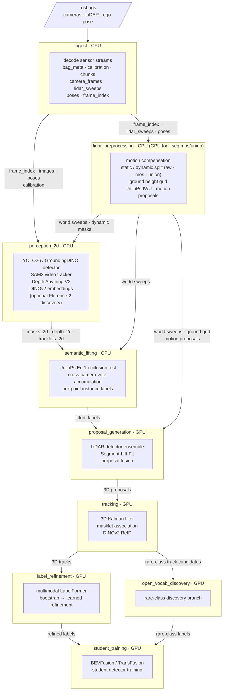

# wato_world

Dockerized offline 3D auto-labeling pipeline for the WATonomous car (EVE):
rosbags (cameras + LiDAR + ego pose) in, 3D box tracks with class labels out.

## Architecture

Nine components communicate only through artifacts on disk (`data/artifacts/`). No in-process imports across component boundaries.



`frame_index.parquet` (written by **ingest**) aligns every LiDAR sweep with the
nearest image per camera. Every pose is looked up from `poses.parquet` through
`wato_common.pose_lookup` at the timestamp of the data being placed — a point,
a sweep, a camera frame — and honours ingest's verdict on which stretches of
the pose stream are trustworthy. `frame_index.world_T_ego` is the sweep's pose
only.

**ingest**, **lidar_preprocessing** and **perception_2d** are implemented end-to-end (and
**semantic_lifting**'s core lifting algorithm). The remaining components are stubs.

## Layout

```
wato_world/
├── watod                    # entrypoint (mirrors wato_monorepo/watod)
├── watod-config.sh          # user-editable defaults
├── watod_scripts/           # helpers invoked by watod
├── src/                         # one Python package per pipeline component
│   ├── common/                  # shared lib: artifact formats, schemas, geometry, poses, tracking
│   ├── ingest/
│   ├── lidar_preprocessing/
│   ├── perception_2d/
│   ├── semantic_lifting/
│   ├── proposal_generation/
│   ├── tracking/
│   ├── label_refinement/
│   ├── open_vocab_discovery/
│   └── student_training/
├── docker/                      # one Dockerfile per component + base + template
├── modules/                     # docker-compose.{yaml,dev,gpu}.yaml
├── config/                      # prompts.yaml; pipeline.yaml (stub components)
├── docs/                        # measurements, bag survey, research notes
└── data/                        # bind-mounted into containers (git-ignored)
```

## Quickstart

```bash
# 1. Put local overrides in a local config file like watod-config.local.sh and make sure it is git-ignored.

# 2. Symlink watod into your PATH (one-time).
./watod install

# 3. Build the active component images.
watod build

# 4. Bring up the active components.
watod up

# 5. Run a component on a bag under data/bags/. Example:
watod run ingest /data/bags/my_bag

# 6. Open a dev shell in an active dev container with source bind-mounted.
# First set ACTIVE_MODULES="perception_2d:dev" in watod-config.local.sh, then:
watod build
watod up
watod -t perception_2d_dev
> pytest /ws/src/perception_2d/tests

# 7. Tear everything down.
watod down all
```

## Components

| Component | Purpose | Image base | GPU |
|---|---|---|---|
| `ingest` | Decode rosbag → frames + lidar + poses + frame_index | CPU | no |
| `perception_2d` | YOLO26 or GroundingDINO detector + SAM2 video tracker + Depth Anything V2 + DINOv2 (optional Florence-2 discovery) | CUDA | yes |
| `semantic_lifting` | Occlusion-aware 2D→3D label lifting (UniLiPs Eq.1) | CPU | no |
| `lidar_preprocessing` | Motion comp, static/dynamic split (`--seg aw\|mos\|union`), ground grid, UniLiPs IWU, recall-oriented motion proposals | CUDA | only for `--seg mos\|union` |
| `proposal_generation` | LiDAR detector + Segment-Lift-Fit + fusion | CUDA | yes |
| `tracking` | 3D Kalman + masklet association + DINOv2 ReID | CUDA | yes (light) |
| `label_refinement` | Multimodal LabelFormer (bootstrap → learned) | CUDA | yes |
| `open_vocab_discovery` | Rare-class discovery branch | CUDA | yes |
| `student_training` | BEVFusion / TransFusion student training | CUDA | yes |

Each component's Python package lives at `src/<component>/src/wato_<component>/`
and is pip-installed editable inside the container.

## Storage

- **Artifact store**: `data/artifacts/` bind-mounted at `/data/artifacts`
  (`ARTIFACT_ROOT_URI`). One layout for every component:
  `raw/<bag_id>/...` and `raw/<bag_id>/chunks/<chunk_id>/...`, built by
  `wato_common.artifact_store`. Local filesystems only — `local_path` refuses
  remote URIs.
- **Artifact formats**: every artifact one component writes and another reads
  has one module in `wato_common.artifacts` (calibration, lidar_sweeps,
  motion_proposals, masklets, depth, lifted_labels) holding both its write and
  read halves, round-trip tested in `src/common/tests`. Consumer images install
  only `src/common` and their own package, so a reader can't live in the
  producer's package.
- **Metadata index**: artifact files themselves. Components write Parquet indexes,
  JSON manifests, and quality reports under `data/artifacts/`; no database
  service is required for the current pipeline.
- **Versioning**: none in the paths — a re-run overwrites. What produced an
  artifact (git commit, lockfile, model revisions, config, input hashes) is in
  the chunk's manifest (`wato_common.manifest`; CLAUDE.md "Provenance").

## Configuration

- `watod-config.sh` — committed defaults (active components, GPU flag, registry).
- `watod-config.local.sh` — optional, git-ignored, sourced after the main
  config. Use it to override per-host values.
- `modules/.env` — auto-generated by `watod_scripts/watod-setup-env.sh`
  on every `watod` invocation. Never edit by hand.

## Development

```bash
# Lint/format locally.
pip install pre-commit && pre-commit install
pre-commit run --all-files

# Run src/common's tests, then a component's, inside its dev container.
watod test ingest
```

## Roadmap

Proposal generation (LiDAR-only first, then Segment-Lift-Fit) → tracking →
bootstrap label refinement (geometric) for the first auto-labels → learned
label refinement, open-vocabulary discovery, student training.
