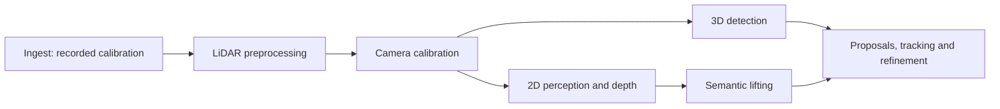

# Camera extrinsic calibration implementation plan

Proposed 2026-11-09 and implemented initially that day. It builds on the
[feasibility investigation](research/camera_recalibration.md#feasibility-of-an-automatic-per-bag-stage).

Current status: the headless backend, adapter, candidate/report artifacts,
independent-correspondence validator, shared selection, cache identity and
pipeline/module registration are implemented. Native synthetic controls pass;
the first WATO NN fit is unstable and is rejected. The supplied profiles stay
disabled and unqualified. Absolute validation still needs independently checked
per-bag correspondences and benchmark-qualified limits; a fully automatic
quality validator and production rollout remain unfinished. See the
[module README](../src/camera_calibration/README.md) and
[measurements](camera_calibration_measurements.md).

## Outcome and scope

Add a bag-level `camera_calibration` module that estimates one constant
`ego_T_cam` per camera, validates it on separate observations, and makes the
accepted calibration available to every camera-dependent stage. Use Koide's
direct visual LiDAR calibration solver as the first backend.

Keep camera intrinsics, distortion, LiDAR mounts, ego poses and exposure
timing fixed. A bag needs finite initial camera transforms and usable poses;
this is refinement of recorded calibration, not recovery of an arbitrary
unknown rig. Detect inconsistent evidence rather than fitting a time-varying
mount or compensating for incorrect odometry with camera rotation.



The new stage belongs after LiDAR preprocessing because it needs deskewed
static returns. It runs before both `detection_3d` and `perception_2d`.
Ingest continues decoding and freezing the calibration supplied by the bag
or `--calibration`. Calibration refinement does not modify the monorepo,
recorded TF, or existing raw images.

## Existing code to build on

| Responsibility | Existing implementation |
| --- | --- |
| Calibration format and recorded reader | [`artifacts/calibration.py`](../src/common/src/wato_common/artifacts/calibration.py) |
| Per-image time and pose, deduplicated within a chunk | [`artifacts/frame_index.py`](../src/common/src/wato_common/artifacts/frame_index.py) |
| World points, optional intensity, aligned dynamic masks | [`artifacts/lidar_sweeps.py`](../src/common/src/wato_common/artifacts/lidar_sweeps.py) |
| WATO point timing and deskew | [`deskew/_core.py`](../src/lidar_preprocessing/src/wato_lidar_preprocessing/deskew/_core.py) |
| Projection and supported image models | [Camera geometry contract](camera_geometry_contract.md) |
| Existing calibration failure evidence | [WATO alignment measurements](semantic_lifting_measurements.md#wato-camera-alignment-july-7-bag-2026-11-03) |
| Pipeline ordering and reruns | [`watod-pipeline.sh`](../watod_scripts/watod-pipeline.sh) |

Do not reuse label-derived point/mask containment as the acceptance reference.
The existing measurements demonstrate that this proxy can prefer the old,
misaligned calibration. Also do not feed `global_static_map.npz` straight to
the solver: [map reduction](../src/lidar_preprocessing/src/wato_lidar_preprocessing/reduce/_core.py)
retains XYZ only, while the intensity objective needs point intensity.

## 1. Prove the backend and coordinate adapter

Do this before integrating a new default into the pipeline.

- Pin Koide at `02a0dc039f5509708f384be4ff3228e0ae09352d` and pin its
  dependencies. Record licenses and any local build changes.
- Package a small multi-pair fixture and an adapter that writes the solver's
  native image/cloud inputs and initial-transform JSON. Invoke the executable
  directly; no ROS messaging, launch system or live topics at runtime.
- Run `calibrate <workdir> --background --auto_quit` in the intended container.
  Establish whether software GL/Xvfb is sufficient. The stock CLI constructs
  a viewer even in background mode; headless operation is a required measured
  deliverable, not an assumption.
- Prefer the stock executable if it works. If its graphics/build coupling
  prevents reliable batch use, make a minimal, revision-pinned file-based
  runner around the existing optimizer. Keep that change local to the backend
  integration and record the patch; do not reimplement the NID optimizer.
- Recover a known synthetic rigid transform across multiple pairs, including
  moving ego poses. Check transform direction and xyzw quaternion order.

Sources: [backend build dependencies](https://github.com/koide3/direct_visual_lidar_calibration/blob/02a0dc039f5509708f384be4ff3228e0ae09352d/CMakeLists.txt),
[CLI initialization and graphics behavior](https://github.com/koide3/direct_visual_lidar_calibration/blob/02a0dc039f5509708f384be4ff3228e0ae09352d/src/calibrate.cpp),
[shared-transform optimizer](https://github.com/koide3/direct_visual_lidar_calibration/blob/02a0dc039f5509708f384be4ff3228e0ae09352d/src/vlcal/calib/visual_camera_calibration.cpp).

**Exit condition:** the backend runs unattended with bounded runtime, reports
failures cleanly, and recovers the fixture's rotation and translation within
predeclared fixture tolerances.

## 2. Add the module and its artifact contract

Use the existing package layout:

```text
src/camera_calibration/
  README.md
  pyproject.toml
  config/camera_calibration.yaml
  config/camera_calibration.wato.yaml
  src/wato_camera_calibration/
    __main__.py, cli.py, config.py, pipeline.py
    sampling.py, inputs.py, solver.py, validation.py, viz.py
  tests/
```

These filenames are proposed implementation locations. Keep the external
interface small: run on one bag with a config, optionally restrict cameras,
and produce calibration plus a report. Sampling, backend execution, coordinate
conversion and validation stay behind that interface. Do not add a generic
backend plugin framework for a single implementation.

Add artifact paths in `wato_common.artifact_store` and one shared read/write
module, `wato_common.artifacts.calibration_refinement`. Reuse `Calibration`
for complete calibration JSONs rather than inventing another matrix format.

```text
raw/<bag_id>/calibration.json                     # recorded/imported baseline
raw/<bag_id>/camera_calibration/
  candidate.json                                # fitted transforms + baseline fields
  effective.json                                # accepted transforms + baseline fields
  report.json                                   # per-camera decisions and evidence
  manifest.json                                 # exact inputs/config/backend identity
  diagnostics/                                  # overlays and residual plots
```

The baseline remains unchanged by the new module. Both candidate and effective
JSONs retain every camera and LiDAR entry. Preserve raw CameraInfo and the TF
dump as provenance; explicitly record that accepted camera overrides can differ
from that dump. Keep solver workspaces and sampled-pair indexes as internal
cache/diagnostic files, not additional cross-stage formats.

Publish the report, effective calibration and final manifest consistently,
using atomic writes and a completion record written last. Prevent two writers
for one bag. Interrupted runs must not appear complete.

Per-camera outcomes:

| Outcome | Meaning | Eligible for validated downstream use? |
| --- | --- | --- |
| `refined` | Candidate passes quality, stability and improvement gates | Yes |
| `recorded_valid` | Recorded transform passes absolute alignment checks; refinement is unnecessary | Yes, use recorded transform |
| `insufficient_evidence` | Too little geometry, coverage or parameter constraint | No |
| `rejected` | Candidate fails validation and baseline is not established as valid | No |
| `error` | Backend or input processing failed | No |
| `not_requested` | Camera was excluded from this run | No |

Report baseline and candidate metrics even when refinement is rejected. An
effective JSON containing an unchanged camera is not by itself evidence that
the camera passed validation.

## 3. Build deterministic image/cloud pairs

1. Read recorded calibration, `FrameIndex`, trusted image-time poses,
   processed sweeps and aligned static masks through their shared readers.
2. Deduplicate overlapping chunks by physical identity: camera ID + image
   timestamp, and LiDAR ID + sweep timestamp. Sample across the bag rather
   than taking many nearly identical adjacent frames.
3. Use an explicitly configured reference LiDAR initially (`lidar_cc` in the
   WATO profile). Verify its identity, availability and intensity quality.
   Do not blend unverified scanners with different intensity responses.
4. Accumulate nearby static returns over a bounded window. Retain intensity,
   remove nonfinite/invalid points, cap points per view, and preserve useful
   ground texture. Downsampling must preserve a defined intensity statistic.
5. Transform each local world cloud into ego coordinates at its paired
   image's own time. Apply bounds/culling conservatively so the starting
   camera error does not remove the evidence needed to correct it.
6. Check image dimensions/model and use the stored image's intrinsics. For
   rectified WATO images use P-derived K with zero distortion. Reject unsupported
   backend models/skew explicitly rather than silently dropping terms.
7. Record a stable sample index, split membership, input fingerprints and
   rejection reasons. Enforce memory, cloud-size and solver-time budgets.

For column vectors, the adapter's coordinate contract is:

```text
p_ego_at_image = inverse(world_T_ego_at_image) @ p_world
p_cam          = inverse(ego_T_cam) @ p_ego_at_image
```

All pairs for one camera can then share one `ego_T_cam`, even while the car
moves. In this adapted workspace Koide's `T_lidar_camera` field actually
contains `ego_T_cam`, because the exported cloud frame is ego. Do not multiply
it by `ego_T_lidar` again.

Use existing WATO deskew, including its all-zero point-time handling, rather
than re-running upstream bag preprocessing with different timing assumptions.

## 4. Fit a candidate without using downstream labels

- Initialize from recorded `ego_T_cam`; initially fit the solver's full rigid
  transform with intrinsics, LiDAR mounts and poses fixed.
- Fit one transform per camera for the bag, not one transform per frame or
  chunk. Use deterministic perturbed starts and independent fitting subsets
  to expose unstable/local solutions.
- Configure plausible correction limits and reject candidates outside them.
  A correction at a limit is diagnostic evidence, not a successful measurement.
  Report both translation in metres and rotation as a rotation-vector/geodesic
  change; avoid subtracting Euler angles as an error metric.
- Do not zero out an unstable fitted translation after optimization and claim
  the original validation still applies. If a rotation-only mode proves needed,
  implement a genuinely constrained optimization and evaluate that exact output
  through all gates; document the required backend extension separately.
- If static geometry or timing subsets require incompatible transforms, report
  insufficient evidence/model inconsistency. Do not export an average as valid.

The solver supplies an estimate; acceptance belongs to the WATO module.

## 5. Implement validation before automatic selection

Freeze sampling, splits and gate configuration before the benchmark run.
Split by separated temporal/spatial blocks, with a guard at least as large
as the accumulation span; account for chunk overlap. Near-identical frames
or shared accumulation windows must not straddle fit and validation splits.
Reserve a final evaluation set that is not used to tune candidates or gates.

Require all applicable gates for a refined camera:

- **Input evidence:** enough independent scene blocks, usable intensity,
  overlapping static geometry, image coverage and near/far depth diversity.
- **Absolute alignment:** held-out static correspondence/edge residuals meet
  a measured quality limit. Lower held-out NID alone is insufficient. Use
  independent manually checked static landmarks/boundaries in the initial
  benchmark to validate the automatic quality metric; only compare matched
  visible structures, with explicit occlusion handling.
- **Improvement:** candidate improves baseline on held-out scenes without
  material regression in another depth range or image region. Bootstrap over
  scene blocks rather than treating correlated points as independent evidence.
- **Stability:** independent starts and fitting subsets agree in both rotation
  and translation. Report uncertainty/constraint diagnostics; optimizer
  termination is not evidence of observability.
- **Plausibility and timing:** corrections stay within measured limits and
  remain consistent across stationary/moving or speed-stratified subsets where
  available. Timing/map inconsistency produces a failed gate, not an extrinsic
  that absorbs it. Stationary-only bags need not fail solely for lacking motion.

The first release must include a repeatable validator beyond solver cost.
Choose numerical thresholds from known-calibration controls and independent
WATO correspondences, then freeze them before final evaluation. Do not label
arbitrary pixel thresholds as established defaults.

Automatic use becomes available once the validation procedure passes these
benchmarks. Before that milestone, the module can emit candidates/reports but
must not describe them as validated. A passing camera needs no per-bag manual
approval; failed cameras retain the baseline for explicit diagnostic use.

## 6. Make calibration selection explicit for consumers

Keep `Calibration.load(bag_id)` reading recorded calibration for compatibility,
ingest, LiDAR processing and the refinement module's own baseline.

Add one shared resolver for camera processing. Its interface takes the bag,
an explicit source (`recorded` or `validated`), and required camera IDs. It
returns calibration plus the exact resolved artifact path/hash and validation
report identity. All camera consumers use this interface instead of repeating
selection logic.

- `recorded` uses the existing calibration and identifies it as recorded.
- `validated` requires a complete, current refinement manifest and allows only
  `refined`/`recorded_valid` for the cameras that caller needs. Missing, stale,
  rejected or unevaluated cameras cause an actionable error. No silent fallback.
- Generic profiles keep `recorded` initially. Enable the module and validated
  source together in the WATO profiles after the benchmark milestone. A
  camera subset run is useful for diagnostics but cannot validate all cameras.

Update detection, perception/depth, lifting, label refinement and camera
overlays. Keep frame-index calibration links documented as ingest provenance;
they must not override the consumer's explicit selection. Diagnostic tools
must identify which calibration they show.

Every affected output manifest records the resolved calibration and decision
report. Validate calibration identity before skipping existing outputs, including
lower-level depth caches. If it changed, fail with the required `--force`/rerun
command rather than reuse stale artifacts. This includes proposal/tracking
outputs through their upstream dependencies, even where they do not load K/T
themselves. Scope the change to calibration invalidation rather than inventing
a new general workflow engine.

## 7. Wire CLI, containers and pipeline execution

Proposed commands, unavailable until implementation:

```bash
./watod run camera_calibration --bag BAG_ID --cameras PANO_NN
./watod run camera_calibration --bag BAG_ID --force
./watod run camera_calibration viz --bag BAG_ID
./watod pipeline --bag BAG_PATH --profile wato_no_lidar_nw
./watod test camera_calibration
```

Provide a bag-level `run`, repeatable diagnostic `viz`, and the existing
`--config`/`--force` conventions. Configuration covers enablement, requested
cameras, reference LiDAR, sampling budgets, backend settings and validation
limits. Do not invent per-chunk calibrations via a `--chunk` shortcut.

Add the module to `watod`, run/test/module discovery, environment image names,
compose deploy/dev definitions, pipeline order and CI change detection. Mirror
monorepo infrastructure and the existing source/dependencies/deploy/develop
image pattern. Isolate Koide's C++/graphics dependencies in this image. Keep
the runtime file-based even if build dependencies include ROS libraries.

Use a bag-level manifest with fingerprints of baseline calibration, relevant
image/pose/sweep inputs, LiDAR manifests, sample selection, config, solver
revision and patches. Reuse only matching completed runs. On `--force
camera_calibration`, force every later stage, without needlessly rebuilding
LiDAR geometry. Changed LiDAR calibration/poses require preprocessing first.

Update the module README, top-level pipeline docs, camera geometry contract,
config comments and `CLAUDE.md` when implementation changes those contracts.

## 8. Verification and rollout

| Check | What it must establish |
| --- | --- |
| Independent synthetic geometry | Recover planted rotation/translation; detect inversion, wrong pose time, duplicated chunks and improper transforms |
| Known-calibration controls | Preserve correct calibration; recover deliberate perturbations without inventing corrections on unperturbed scenes |
| Failure controls | Missing intensity, weak texture/geometry, bad poses, mismatched image models and inconsistent timing fail explicitly |
| Artifact and resolver integration | Partial runs, stale fingerprints, failed cameras and missing reports cannot enter validated downstream processing |
| Backend/container smoke run | Unattended bounded execution, native input/output compatibility and useful failure logs |
| July WATO PANO_NN benchmark | Improve independently checked static alignment on held-out observations; demonstrate parameter stability and explain rejected fits |
| Remaining cameras and second recording | Establish which cameras are constrained and whether the method generalizes, without relaxing gates to force acceptance |
| Pipeline comparison | All camera-dependent stages and overlays use the same accepted calibration; baseline remains reproducible |

Start with the July bag
`sensors_2026_07_07_23_01_24_2_with_eidos_mcap`, preserving its
`wato_no_lidar_nw` profile. Use separate artifact roots or comparison bag IDs
for baseline/refined downstream runs. The earlier epipolar rotations are useful
diagnostic comparisons, not physical ground truth or the acceptance target.
Include a known-calibration nuScenes control because an earlier epipolar
experiment preferred a spurious correction there.

Record alignment residual distributions, scene counts, correction magnitude,
stability, coverage, runtime and peak memory. Downstream depth/lifting results
are secondary evidence, not the calibration acceptance metric. Publish the
results in `docs/camera_calibration_measurements.md` when measured.

## Suggested implementation sequence

1. **Backend spike and NN exporter:** establish coordinate correctness,
   unattended execution and an initial candidate; no consumer changes.
2. **Validation benchmark:** independent static correspondences, negative
   controls and rejection behavior; freeze the acceptance procedure.
3. **Module and artifacts:** typed report, deterministic sampling, repeatable
   solver runs, atomic output and provenance.
4. **Shared selection and invalidation:** integrate all camera consumers and
   verify that cached outputs cannot mix calibrations.
5. **Pipeline rollout:** package and register the module, evaluate remaining
   cameras/another recording, then enable validated WATO processing.

Completion means one command can produce a reproducible per-bag report and
calibration selection, accepted cameras improve independent alignment, failed
cameras remain explicit, and downstream outputs can be traced to the exact
calibration used. Rejection on an unsuitable bag is a supported outcome.
